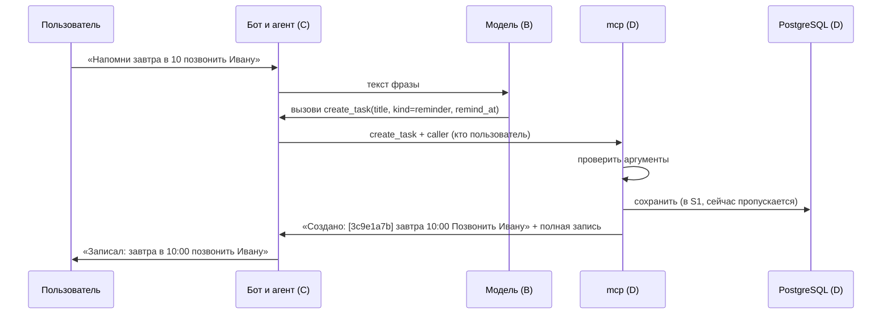
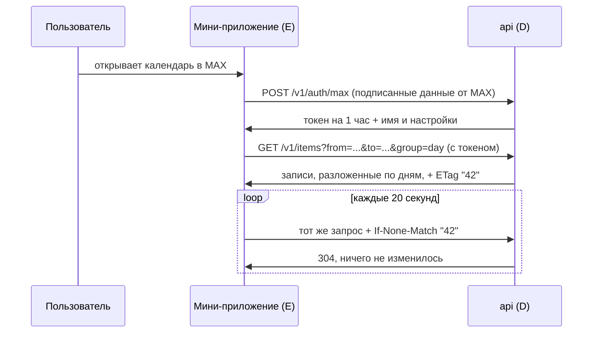

# Бэкенд D простыми словами

Документ для человека, который впервые открыл репозиторий. Здесь описано, что уже сделано, что происходит
внутри бэкенда, когда пользователь что-то делает, и зачем нужен каждый файл. Технические детали и история решений
лежат в [`PROJECT_LOG.md`](PROJECT_LOG.md), план команды — в [`plan/`](plan/).

---

## 1. Что это вообще такое

Мы делаем голосового помощника для задач и встреч в мессенджере MAX. Пользователь пишет или говорит боту
«напомни завтра в 10 позвонить Ивану», а помощник сохраняет напоминание и потом напоминает. Ещё есть
мини-приложение внутри MAX: в нём видно календарь со всеми записями.

Команда из пяти человек делит работу так:

| Кто | Что делает |
| --- | --- |
| A | Превращает голосовое сообщение в текст |
| B | «Мозг»: языковая модель понимает фразу и решает, какое действие выполнить |
| C | Бот в MAX и агент, который связывает всех между собой |
| **D (мы)** | **Хранит данные: сохраняет, находит, отдаёт, напоминает** |
| E | Мини-приложение с календарём |

Роль D — это «склад и картотека» всей системы. Никто, кроме D, не ходит в базу данных. Остальные просят D
через два входа:

- **MCP** — вход для агента (роль C). Через него языковая модель «нажимает кнопки»: создать задачу, найти, перенести.
- **API** — вход для мини-приложения (роль E). Через него календарь получает записи, чтобы их нарисовать.

---

## 2. Что уже сделано (этап S0)

Сейчас это **каркас и заглушки**. Настоящей базы с записями ещё нет. Но оба входа уже работают и отвечают
**готовыми примерами** в правильном формате. Зачем так:

- Агент (C) и мини-приложение (E) могут писать свой код уже сейчас, не дожидаясь, пока D сделает настоящую логику.
- Формат ответов (контракт) зафиксирован в коде и проверяется тестами. Когда D сделает настоящую логику,
  ответы останутся в том же формате, и у других ничего не сломается.

Что конкретно работает:

1. Сервис **`mcp`**: 8 «кнопок» (инструментов) для агента. Он проверяет, что агент прислал правильные данные,
   и отвечает примером.
2. Сервис **`api`**: адреса для мини-приложения (вход, мои настройки, записи по дням, поиск, карточка записи).
   Он отвечает примерами.
3. У обоих сервисов есть «пульс» (`/health`): по нему видно, что сервис жив и видит базу данных и Redis.
4. Всё это собирается в один Docker-образ и поднимается одной командой вместе с базой (`compose.yaml`).
5. 105 автоматических тестов проверяют, что примеры, модели и описание API не разъехались.

---

## 3. Что происходит, когда пользователь что-то делает

Ниже два главных сценария. Для каждого написано, как будет работать в итоге и что из этого есть уже сейчас.

### Сценарий А. Пользователь пишет боту «Напомни завтра в 10 позвонить Ивану»



Пошагово, что делает D:

1. Агент присылает вызов инструмента `create_task` с аргументами, которые придумала модель (название, время),
   и служебной частью `caller`: кто пользователь, его часовой пояс, номер цепочки для логов.
   `caller` заполняет агент, а не модель: модель не может «подсунуть» чужого пользователя.
2. D проверяет аргументы по контракту (`libs/contracts/tools.py`):
   - время обязательно со смещением (`+03:00`), иначе непонятно, в каком поясе «10 утра»;
   - название от 1 до 200 символов;
   - id записи — полный или первые 8 символов.
3. Если чего-то не хватает, D отвечает ошибкой `validation_error` и перечисляет, каких полей нет
   (`details.missing: ["starts_at"]`). Модель видит это и переспрашивает пользователя: «На какое время?».
   Это уже работает.
4. Если всё в порядке, D сохраняет запись в базу. **Сейчас этого нет**: заглушка сразу отдаёт готовый пример. Появится в S1.
5. D отвечает двумя частями: короткой строкой для модели («Создано: [3c9e1a7b] завтра 10:00 Позвонить Ивану»)
   и полной записью в JSON для агента, чтобы тот нарисовал подтверждение и кнопки.

Если встреча пересекается с другой, это **не ошибка**: D ответит `status: "conflict"`, перечислит, с чем пересекается,
и предложит свободное время. Агент сразу покажет кнопки «Перенести на 16:00».

Все 8 инструментов:

| Инструмент | Что делает для пользователя |
| --- | --- |
| `create_task` | Создать задачу или напоминание |
| `create_event` | Создать встречу |
| `list_items` | Показать записи за период («что у меня на неделе») |
| `search_items` | Найти по смыслу («когда я говорил про дизайнера») |
| `update_item` | Изменить или перенести («перенеси на час позже») |
| `complete_item` | Отметить выполненным |
| `delete_item` | Удалить или вернуть удалённое |
| `check_conflicts` | Проверить, свободно ли время |

### Сценарий Б. Пользователь открывает календарь в мини-приложении



Пошагово:

1. **Вход.** MAX передаёт мини-приложению подписанную строку с данными пользователя (`initData`). Приложение отправляет
   её в `POST /v1/auth/max` и получает токен. **Сейчас** подпись не проверяется и выдаётся пример токена.
   Настоящая проверка будет в S2.
2. **Все остальные запросы — с токеном.** Без токена API отвечает 401. Это уже работает: фронт может с первого дня
   учиться обрабатывать «нужно войти заново».
3. **Записи по дням.** Приложение просит период, и API отдаёт его по дням, включая пустые, с готовыми подписями
   («Пн, 19 октября»). Фронту не нужно думать про часовые пояса: время уже в поясе пользователя.
4. **Дешёвое обновление.** В ответе есть `ETag` — номер версии данных пользователя. Приложение раз в 20 секунд
   спрашивает «изменилось ли что-то после версии 42». Если нет, API отвечает коротким 304 без данных. Так задача,
   созданная голосом в боте, быстро появится в календаре. Это уже работает на примере.
5. **Поиск и карточка** — `GET /v1/items/search?q=...` и `GET /v1/items/{id}`. Чужая или несуществующая запись даёт
   одинаковый ответ 404, чтобы нельзя было подобрать чужие id.
6. **Настройки** — `GET` и `PATCH /v1/me`: часовой пояс, голосовые ответы, длительность встречи по умолчанию,
   за сколько минут напоминать.

### Что видит пользователь при ошибке

Любая ошибка от D приходит в одном формате:

```json
{"error": {"code": "not_found", "message": "Запись не найдена", "details": {"id": "..."}, "trace_id": "ab12f0c4..."}}
```

- `code` — что случилось, из 10 кодов (`validation_error`, `unauthorized`, `not_found`, `past_time` и т. д.).
  По нему бот и фронт выбирают понятный текст для пользователя.
- `trace_id` — номер цепочки. Если пользователь пожалуется, по нему найдём запрос в логах.

---

## 4. Зачем каждая папка и файл

```text
iNote/
├── libs/                       общий код, который импортируют сервисы
│   ├── contracts/              «договоры» между ролями
│   └── core/                   логика роли D
├── services/                   то, что запускается как отдельный сервис
│   ├── mcp/                    вход для агента
│   └── api/                    вход для мини-приложения
├── contracts/                  примеры и описание API в виде файлов
│   ├── examples/
│   └── openapi/
├── docs/                       документация
├── compose.yaml                поднять всё одной командой
├── Dockerfile                  как собрать образ сервисов D
└── pyproject.toml              список библиотек и настройки проверок
```

### `libs/contracts/` — договоры между ролями

Это главное, что D отдаёт другим. Здесь описано, **в каком виде** данные ходят между частями системы.
Логики тут нет, только описание полей и их правил. Если формат меняется, он меняется здесь, и все видят изменение.

| Файл | Что внутри | Простыми словами |
| --- | --- | --- |
| `items.py` | `Item`, `ItemBrief` | Как выглядит одна запись: название, время, статус, участники. `ItemBrief` — короткая версия для списков |
| `settings.py` | `UserSettings` | Настройки пользователя: часовой пояс, голосовые ответы, длительность встречи, напоминание. Неизвестный пояс не пройдёт |
| `errors.py` | коды ошибок и формат ошибки | 10 видов ошибок и какой HTTP-код у каждой |
| `tools.py` | аргументы и ответы 8 инструментов | Что агент должен прислать в каждый инструмент и что получит в ответ |
| `api.py` | запросы и ответы `/v1` | Что мини-приложение отправляет и получает |
| `health.py` | ответ `/health/ready` | Формат «пульса» сервиса |

### `libs/core/` — логика D

Сейчас здесь только служебные вещи. В S1–S3 сюда придёт основная логика: работа с базой, поиск, конфликты, напоминания.
Правило: логика живёт здесь, а `mcp` и `api` только принимают запрос и передают его сюда. Тогда одна и та же логика
работает и для бота, и для мини-приложения.

| Файл | Зачем |
| --- | --- |
| `config.py` | Читает настройки из окружения (адрес базы, Redis, уровень логов). Если чего-то нет, сервис сразу падает с понятной ошибкой, а не ломается потом |
| `resources.py` | Создаёт подключения к PostgreSQL и Redis |
| `health.py` | Проверяет, отвечают ли PostgreSQL и Redis, не дольше 2 секунд каждый |
| `validation.py` | Превращает ошибки проверки в список «чего не хватает» и «что неверно», без самих значений (это личные данные) |
| `log_setup.py` | Настройка логов. Временный файл: по плану логи даст общая библиотека роли C |

### `services/mcp/` — вход для агента

| Файл | Зачем |
| --- | --- |
| `app.py` | Собирает сервис: `/health` и MCP на адресе `/mcp`. Разрешает подключение по имени `mcp` внутри Docker |
| `tools/stub.py` | **Заглушка** 8 инструментов: проверяет аргументы и отвечает примером. В S1 её заменят настоящие инструменты, по файлу на каждый |

### `services/api/` — вход для мини-приложения

| Файл | Зачем |
| --- | --- |
| `app.py` | Собирает сервис: `/health` и адреса `/v1` |
| `errors.py` | Любую ошибку превращает в общий формат с `trace_id` |
| `routes/stub.py` | **Заглушка** адресов `/v1`: отвечает примерами. В S2 её заменят настоящие адреса |
| `export_openapi.py` | Сохраняет описание API в `contracts/openapi/api.json` |

### `services/http_common.py`

Общий кусок для `mcp` и `api`: при старте открыть подключения к базе и Redis, при остановке закрыть, и адреса `/health`.
Он временный: по плану то же самое даст общая библиотека роли C.

### `contracts/` — примеры и описание API

| Папка | Зачем |
| --- | --- |
| `examples/j3/` | Пример на каждый инструмент: что прислали, что вернули, какую строку увидит модель. На них отвечает заглушка, по ним B и C пишут свой код |
| `examples/j5/` | Примеры запросов и ответов API. На них отвечает заглушка, из них E делает моки |
| `openapi/api.json` | Полное описание API в стандартном формате. E генерирует из него типы для фронта |

Тесты сверяют примеры с договорами из `libs/contracts`. Если кто-то поменяет договор и забудет пример, тест упадёт.

### `docs/`

| Файл | Зачем |
| --- | --- |
| `BACKEND_D_EXPLAINED.md` | Этот документ |
| `PROJECT_LOG.md` | Подробный журнал: текущее состояние, все решения и кто их принял, отчёты по шагам |
| `STRUCTURE_DRAFT.md` | Черновик структуры репозитория для всей команды, обсуждается на встрече G0 |
| `plan/` | Копии плана команды |

### Файлы в корне

| Файл | Зачем |
| --- | --- |
| `compose.yaml` | Поднимает базу (PostgreSQL с расширением для поиска по смыслу), Redis, `mcp` и `api` одной командой |
| `Dockerfile` | Собирает один образ для всех сервисов D. Сервисы отличаются только командой запуска. Чужой код в образ не попадает |
| `pyproject.toml` | Какие библиотеки нужны и настройки проверок (ruff, pytest) |
| `.env.example` | Список настроек окружения без паролей. Настоящие значения кладутся в `.env`, который не попадает в git |
| `.gitignore`, `.dockerignore` | Что не попадает в git (пароли, виртуальное окружение) и в Docker-образ (тесты, документация) |

Тесты лежат рядом с кодом, в папках `tests/` внутри `libs/contracts`, `libs/core` и `services`.

### Чем `libs/contracts/` отличается от `contracts/`

Обе папки про договоры между ролями, но хранят их в разном виде:

| | `libs/contracts/` | `contracts/` |
| --- | --- | --- |
| Что это | Python-код: описание полей и правил | Обычные файлы: JSON-примеры и описание API |
| Пример | «`title` — строка от 1 до 200 символов, время только со смещением» | «Вот так выглядит настоящий ответ `create_task`» |
| Кто пользуется | Python-сервисы: импортируют и проверяют данные | Все, включая тех, кто пишет не на Python: фронт E (TypeScript) берёт отсюда типы и моки, B и C смотрят примеры |
| Что главнее | Правила (источник правды) | Производное: примеры проверяются тестами против правил, `api.json` выгружается из кода |

Проще говоря, `libs/contracts/` — это **правила**, а `contracts/` — **образцы и документ** по этим правилам.
Так разделить предлагает план команды (КиП): «каждый стык описан кодом в `libs/contracts` и примерами в `contracts/examples/`».

### Полный список файлов и папок

| Путь | Что делает |
| --- | --- |
| `README.md` | Заголовок репозитория (пока пустой) |
| `.gitignore` | Что не попадает в git |
| `.dockerignore` | Что не попадает в Docker-образ |
| `.env.example` | Список настроек без паролей |
| `Dockerfile` | Сборка образа сервисов D |
| `compose.yaml` | Запуск базы, Redis, mcp и api |
| `pyproject.toml` | Библиотеки и настройки проверок |
| **`libs/`** | Общий код для сервисов |
| `libs/__init__.py` | Делает папку пакетом Python |
| **`libs/contracts/`** | Правила форматов между ролями |
| `libs/contracts/__init__.py` | Делает папку пакетом Python |
| `libs/contracts/items.py` | Формат записи (`Item`, `ItemBrief`) |
| `libs/contracts/settings.py` | Формат настроек пользователя |
| `libs/contracts/errors.py` | Коды и формат ошибок |
| `libs/contracts/tools.py` | Аргументы и ответы 8 инструментов |
| `libs/contracts/api.py` | Запросы и ответы API `/v1` |
| `libs/contracts/health.py` | Формат ответа `/health/ready` |
| `libs/contracts/tests/` | Тесты правил форматов |
| `libs/contracts/tests/__init__.py` | Делает папку пакетом Python |
| `libs/contracts/tests/test_items.py` | Проверяет формат записи |
| `libs/contracts/tests/test_settings.py` | Проверяет настройки и часовые пояса |
| `libs/contracts/tests/test_errors.py` | Проверяет коды и формат ошибок |
| `libs/contracts/tests/test_tools.py` | Сверяет примеры J3 с правилами |
| `libs/contracts/tests/test_api.py` | Сверяет примеры J5 с правилами |
| **`libs/core/`** | Логика роли D |
| `libs/core/__init__.py` | Делает папку пакетом Python |
| `libs/core/config.py` | Читает настройки окружения |
| `libs/core/resources.py` | Подключается к базе и Redis |
| `libs/core/health.py` | Проверяет базу и Redis |
| `libs/core/validation.py` | Перечисляет неверные поля |
| `libs/core/log_setup.py` | Настраивает логи (временно) |
| `libs/core/tests/` | Тесты логики D |
| `libs/core/tests/__init__.py` | Делает папку пакетом Python |
| `libs/core/tests/test_config.py` | Проверяет чтение настроек |
| `libs/core/tests/test_health.py` | Проверяет недоступную базу и Redis |
| **`services/`** | Запускаемые сервисы |
| `services/__init__.py` | Делает папку пакетом Python |
| `services/http_common.py` | Общий старт и `/health` (временно) |
| **`services/mcp/`** | Вход для агента |
| `services/mcp/__init__.py` | Делает папку пакетом Python |
| `services/mcp/app.py` | Собирает сервис mcp |
| `services/mcp/tools/` | Инструменты для модели |
| `services/mcp/tools/__init__.py` | Делает папку пакетом Python |
| `services/mcp/tools/stub.py` | Заглушка 8 инструментов |
| **`services/api/`** | Вход для мини-приложения |
| `services/api/__init__.py` | Делает папку пакетом Python |
| `services/api/app.py` | Собирает сервис api |
| `services/api/errors.py` | Переводит ошибки в общий формат |
| `services/api/export_openapi.py` | Сохраняет описание API в файл |
| `services/api/routes/` | Адреса API |
| `services/api/routes/__init__.py` | Делает папку пакетом Python |
| `services/api/routes/stub.py` | Заглушка адресов `/v1` |
| `services/tests/` | Тесты сервисов |
| `services/tests/__init__.py` | Делает папку пакетом Python |
| `services/tests/test_health_routes.py` | Проверяет `/health` у mcp и api |
| `services/tests/test_mcp_stub.py` | Проверяет MCP-заглушку клиентом |
| `services/tests/test_api_stub.py` | Проверяет заглушку API и `api.json` |
| **`contracts/`** | Образцы и описание API в файлах |
| `contracts/examples/` | JSON-примеры по стыкам |
| `contracts/examples/j3/` | Примеры для инструментов (J3) |
| `contracts/examples/j3/create_task.json` | Пример: создать задачу |
| `contracts/examples/j3/create_event.json` | Пример: встреча с конфликтом |
| `contracts/examples/j3/list_items.json` | Пример: записи за период |
| `contracts/examples/j3/search_items.json` | Пример: поиск по смыслу |
| `contracts/examples/j3/update_item.json` | Пример: перенос напоминания |
| `contracts/examples/j3/complete_item.json` | Пример: отметить выполненным |
| `contracts/examples/j3/delete_item.json` | Пример: удалить запись |
| `contracts/examples/j3/check_conflicts.json` | Пример: проверить свободное время |
| `contracts/examples/j3/error_past_time.json` | Пример ошибки инструмента |
| `contracts/examples/j5/` | Примеры для API (J5) |
| `contracts/examples/j5/auth_max.request.json` | Пример: запрос входа |
| `contracts/examples/j5/auth_max.response.json` | Пример: ответ входа с токеном |
| `contracts/examples/j5/me.response.json` | Пример: имя и настройки |
| `contracts/examples/j5/me_patch.request.json` | Пример: изменить настройки |
| `contracts/examples/j5/me_patch.response.json` | Пример: настройки после изменения |
| `contracts/examples/j5/items_by_day.response.json` | Пример: записи по дням |
| `contracts/examples/j5/items.response.json` | Пример: записи списком |
| `contracts/examples/j5/items_search.response.json` | Пример: результат поиска |
| `contracts/examples/j5/item.response.json` | Пример: одна запись |
| `contracts/openapi/` | Описание API для фронта |
| `contracts/openapi/api.json` | Полное описание API (OpenAPI) |
| **`docs/`** | Документация |
| `docs/BACKEND_D_EXPLAINED.md` | Этот документ |
| `docs/PROJECT_LOG.md` | Журнал: состояние, решения, отчёты |
| `docs/STRUCTURE_DRAFT.md` | Черновик структуры репо для G0 |
| `docs/plan/` | Копии плана команды |
| `docs/plan/Команда и протоколы 2.md` | Общие стандарты и стыки J1–J8 |
| `docs/plan/D · MCP БД API Scheduler.md` | План роли D |

Файлы `__init__.py` пустые: они нужны только для того, чтобы Python понимал папку как пакет и работали импорты
вида `from libs.contracts.items import Item`.

Не попадают в git и в таблицу: `.venv/` (локальные библиотеки), `.idea/` (настройки PyCharm), `__pycache__/`,
`.pytest_cache/`, `.ruff_cache/`, `*.egg-info/` (служебные файлы Python, pytest и ruff).

---

## 5. Как проверить самому

```bash
python -m venv .venv
.venv/Scripts/python -m pip install -e ".[dev]"
.venv/Scripts/python -m pytest -q        # 105 passed
```

Запустить API и посмотреть все адреса в браузере:

```bash
DATABASE_URL=postgresql://u:p@localhost:5432/db REDIS_URL=redis://localhost:6379/0 .venv/Scripts/uvicorn services.api.app:app --port 8000
```

Потом открыть `http://localhost:8000/docs`: там можно нажимать адреса и смотреть ответы. Без базы `/health/ready`
ответит 503, это нормально, остальное работает. С Docker всё поднимается командой `docker compose up --build`.

---

## 6. Чего ещё нет

| Чего нет | Когда будет |
| --- | --- |
| Настоящая база с таблицами и сохранение записей | S1 (нужна размерность эмбеддингов от A) |
| Поиск по смыслу | S2 |
| Проверка подписи MAX и настоящий токен | S2 |
| Напоминания по расписанию (Scheduler) | S3 |
| Служебный вход для агента `/internal/v1` (пользователи, история) | следующий шаг или S1 |
| Проверка сервисного токена и логи с `trace_id` | когда роль C выложит `libs/common` |
| Тексты описаний инструментов для модели | пишет роль B |
