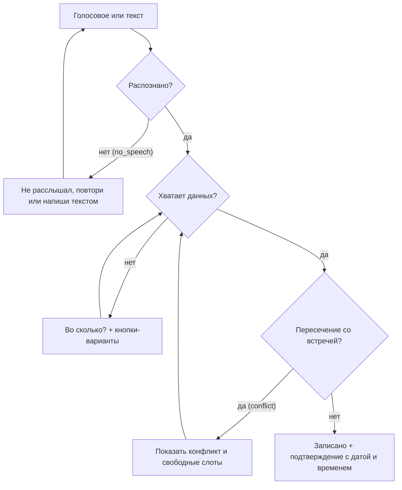

# 03. Карта пользовательских историй (USM)

**Вывод.** MVP закрывает весь путь пользователя: записать дело голосом или текстом, поправить его, получить напоминание, увидеть план в чате или в календаре мини-приложения и найти старую запись по смыслу. Этого достаточно, чтобы показать все обязательные сценарии ТЗ голосом.

Рамка карты: один пользователь с одной целью — не пропустить дело, которое пришло в неудобный момент. Путь начинается с первого открытия бота в MAX и заканчивается, когда дело сделано вовремя. Каналы — бот в MAX и мини-приложение MAX app.

## Карта MVP

| Начать | Записать дело | Изменить | Получить напоминание | Посмотреть план | Найти старое |
| --- | --- | --- | --- | --- | --- |
| Старт бота | Голос или текст → задача, напоминание или встреча | «Перенеси её на завтра» | Сообщение в MAX в срок | «Что у меня сегодня?» — список в чате | Поиск по смыслу |
| Часовой пояс в `/settings` | Уточнение с кнопками, если не хватает времени | «Отметь выполненным» | О встрече — за час до начала | Календарь в мини-приложении: день, неделя, месяц | Несколько вариантов, если совпадение неуверенное |
| | Пересечение встреч → свободные слоты | «Удали» или кнопка «Отменить» | Кнопка «Отложить на 1 ч» | | |

Сверху вниз — по важности.

## Шаги

| Шаг | Что делает продукт |
| --- | --- |
| Начать | Регистрирует пользователя при первом сообщении; часовой пояс по умолчанию — Москва, меняется в `/settings` |
| Записать дело | Голос → текст → намерение → задача, напоминание или встреча; при нехватке данных — уточнение с готовыми кнопками; при пересечении встреч — конфликт и свободные слоты |
| Изменить | Перенос, выполнение и удаление записи, о которой только что шла речь, — без повторного названия |
| Напоминание | Scheduler отправляет напоминание в срок; о встрече — за час до начала |
| Посмотреть план | Список в чате, сгруппированный по дням; кнопка открывает календарь в мини-приложении; календарь сам подхватывает записи, созданные голосом |
| Найти старое | Поиск по смыслу: при создании записи GigaChat добавляет синонимы, поиск учитывает окончания и опечатки; если совпадение неуверенное — несколько вариантов |

**Почему напоминание в MVP, хотя ТЗ его не требует.** ТЗ просит сохранить запись. Но пользователь «нанимает» продукт, чтобы не пропустить дело, а не чтобы записи где-то хранились.

**Подтверждение — с датой и временем целиком**, а не «Готово»: иначе пользователь не заметит, если бот понял «четверг» неправильно. Текст подтверждения строится из результата инструмента, а не из ответа модели, поэтому бот не скажет «записал», если в базе ничего не появилось.

## Несчастливые пути при записи дела

Каждый сбой заканчивается вопросом или понятным действием, а не тишиной.

### Другие несчастливые пути

| Ситуация | Код | Ответ |
| --- | --- | --- |
| Голосовое длиннее 30 с | `audio_too_long` | Просьба записать короче или написать текстом |
| ASR недоступен или не ответил | `upstream_unavailable`, `upstream_timeout` | «Не получилось распознать, напиши текстом» |
| Час без «утра» или «вечера»: «в 5» | — | «Утра или вечера?» с кнопками |
| Время уже прошло: «напомни в 9», сказанное в 10 | `past_time` | Бот сообщает, что время прошло, и предлагает другое |
| Поиск нашёл несколько похожих | `best_match_confident = false` | Несколько ближайших записей с датами на выбор |
| Ошибка LLM | `llm_timeout`, `llm_rate_limited`, `llm_bad_output`, `llm_no_action` | Понятный текст по коду ошибки, а не исключение |
| Ответ дольше нескольких секунд | бюджет до 45 с | Статус «печатает…», пока идёт обработка |

## Демо-сценарий

1. Пользователь открывает бота; часовой пояс по умолчанию — Москва.
2. Голосом: «Встреча с Иваном завтра». Бот: «Во сколько?» и кнопки. Нажимает «15:00».
3. Бот: встреча с Иваном, завтра, вс 18 октября, 15:00–16:00.
4. Голосом: «Перенеси её на пять вечера». Бот переносит встречу на 17:00–18:00 и подтверждает.
5. «Что у меня завтра?» — список в чате и кнопка календаря; в мини-приложении встреча уже на месте.
6. За час до начала приходит напоминание.
7. Через неделю: «Когда я встречался с Иваном?» — бот находит запись по смыслу.
