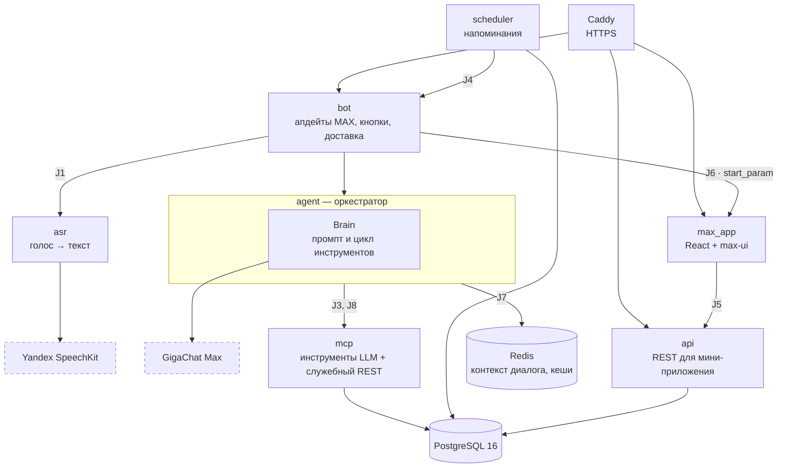

# 06. Архитектура

**Вывод.** Продукт состоит из независимых сервисов в Docker Compose, связанных контрактами J1–J8. Голос распознаёт Yandex SpeechKit, смысл фразы разбирает GigaChat Max, записи хранятся в PostgreSQL 16. В базу ходят только сервисы зоны данных, агент работает с ней через MCP.

## Схема

## Компоненты

| Зона | Компонент | Что делает |
| --- | --- | --- |
| A — речь | `asr` | Переводит голосовое до 30 с в текст через Yandex SpeechKit |
| B — LLM и промпт | Brain | Промпт и цикл инструментов GigaChat Max: понимает фразу, вызывает инструмент или задаёт уточнение. Дату и время из фразы считает код, а не модель |
| C — бот и агент | `bot` | Принимает сообщения из MAX, показывает кнопки, доставляет ответы и напоминания |
| C — бот и агент | `agent` | Оркестратор: хранит контекст диалога, вызывает Brain и инструменты MCP, собирает ответ. Кнопки и команды выполняет без LLM |
| C — бот и агент | Redis | Контекст диалога, незавершённые уточнения, кеши |
| D — данные | `mcp` | 8 инструментов для LLM: создать задачу или встречу, список, поиск, изменить, выполнить, удалить, проверить пересечения. Служебный REST для пользователей и истории диалога |
| D — данные | `scheduler` | Раз в 15 с находит наступившие напоминания и передаёт их боту |
| D — данные | `api` | REST для мини-приложения: записи за период, поиск; вход по JWT. Только чтение |
| D — данные | PostgreSQL 16 | Пользователи, записи, напоминания, история диалога |
| E — фронт | `max_app` | Календарь на React и max-ui: день, неделя, месяц |

## Контракты

| Стык | Кто → кому | Что передаёт |
| --- | --- | --- |
| J1 | Бот → ASR | Голосовое → текст |
| J2 | Агент ↔ Brain | Реплика пользователя → результат хода: действие, уточнение или ответ; Python-интерфейс, не сетевой вызов |
| J3 | Агент → MCP | Вызовы инструментов по протоколу MCP; `user_id` подставляет агент, а не модель |
| J4 | Scheduler → бот | Уведомление о наступившем напоминании |
| J5 | MAX app → API | REST с JWT; календарь опрашивает API раз в 20 с |
| J6 | Бот → MAX app | `start_param` открывает нужный экран: сегодня, день или неделя |
| J7 | Все → Redis | Реестр ключей `va:v1:<сервис>:<сущность>:<id>` |
| J8 | Агент → MCP-контейнер | Служебный REST: пользователь, часовой пояс, история диалога |

## Путь одного голосового

1. Бот получает голосовое и отправляет его в ASR (J1), получает текст.
2. Агент передаёт текст, историю и контекст диалога в Brain (J2). Код разбирает дату и время, GigaChat Max выбирает инструмент.
3. Если не хватает данных — бот задаёт уточнение с кнопками; иначе агент вызывает инструмент MCP (J3), и запись сохраняется в PostgreSQL.
4. Бот подтверждает запись с датой и временем, взятыми из результата инструмента.
5. Мини-приложение при следующем опросе API (J5) показывает новую запись в календаре.
6. В срок Scheduler находит запись в базе и через бота (J4) отправляет напоминание.

Все внешние сервисы — российские: MAX, Yandex SpeechKit, GigaChat. Данные хранятся в РФ.
